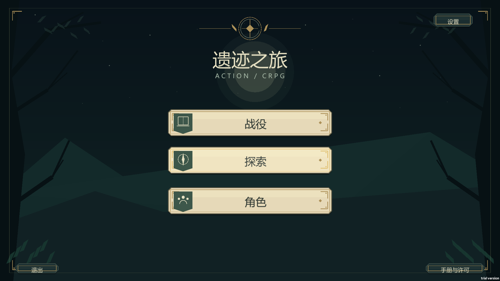
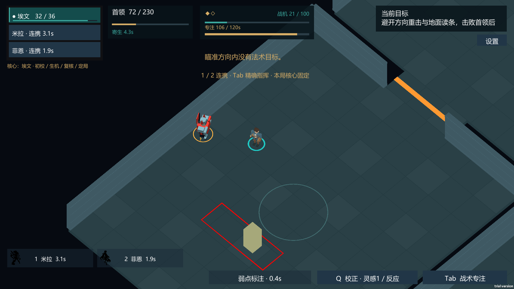

# 遗迹之旅 · test_for_dnd

一个用 Unity 和 C# 实现的俯视角 3D 动作 CRPG 原型。玩家从三人小队中选择本局的构筑核心，穿过六个房间，在末房利用柱体、节点和走位应对两阶段 Boss。手动攻击、骰子判定和暂停式战术指挥共享行动资源。



## 试玩与操作

在仓库的 **Releases** 下载 `test_for_dnd_windows_x64.zip`，完整解压后运行 `ActionCRPG.exe`。进入「探索」选择三位角色、构筑核心和战斗模式，再出发。

| 操作 | 键位 |
| --- | --- |
| 移动、普通攻击、守势、闪避 | WASD、鼠标左键、鼠标右键、空格 |
| 当前角色主动技能 | F、Q |
| 小队战术模式切换角色 | 1 / 2 / 3 |
| 主控连携模式请求两名队友 | 1 / 2 |
| 战术指挥、场景交互 | Tab、E |

小队战术让三人常驻场景。主控连携让支援角色在触发招牌技能时短暂入场。出发时冻结模式、队伍和构筑核心，读档沿用该局快照。房间奖励、技能槽和存档说明见[操作指南](Docs/V14_PLAYER_GUIDE.md)和[存档说明](Docs/V14_SAVE_COMPAT.md)。

## 从源码运行

1. 在 Unity Hub 中安装 **2022.3.62f3c1** 和 Windows Standalone 支持，添加本仓库根目录。首次导入需要下载锁文件指定的包。
2. 打开 `Assets/CombatV051/Generated/CombatP0.unity`，点击 **Play**。该场景也是 Build Settings 中启用的启动场景。
3. 在 **Window → General → Test Runner** 分别运行 EditMode 与 PlayMode。前者覆盖规则、序列化和兼容合同，后者覆盖实际场景对象、输入桥接、技能和 UI。

## C# 系统与资源边界

| 在哪里看 | 实现 |
| --- | --- |
| `Assets/CombatV051/Domain/` | 骰子、行动消耗、伤害、奖励、队伍、Boss 阶段和持久化数据。战斗状态通过稳定 ID 保存。 |
| `Runtime/BattleWorld*.cs`、`BattleInput.cs` | 世界装配、输入与规则调用。小队切换和主控连携走同一套费用、冷却与行动规则。 |
| `Runtime/FixedBattleCamera.cs`、`Runtime/FrontendSilhouette.cs` | 固定 3/4 视角与角色选择剪影。主菜单、探索准备、战斗 HUD 和战术指挥由运行时 UI 组织。 |
| `Resources/`、`Generated/` | 角色预制体、音效与音乐、AudioMixer、战斗/地牢 JSON、URP 配置和启动场景。保留按字符串动态加载的资源。 |
| `Editor/`、`Tests/` | 故事文本导入、既有场景构建器、规则和引擎内测试。 |
| `StorySource/`、`Tools/` | 可编辑故事文本与配置生成工具。日常打开和游玩只需要 Unity。 |

表内缩写目录位于 `Assets/CombatV051/`。渲染使用 URP 14.0.12，输入使用 Input System 1.7.0，UI 使用 uGUI；Windows 构建后端为 Mono。



两张截图来自同一 V14 BUILD02 源线的历史 Windows Player 实机记录。当前导出另行完成了干净导入、构建和自动输入验证。

## 构建 Windows x64

在根目录执行以下 PowerShell。设置 `UNITY_EDITOR` 指向上述版本的 `Unity.exe`。构建器要求输出为项目 `Builds/` 下的新目录，并校验场景 GUID 及构建期间已有输入文件的哈希。

```powershell
$project = (Get-Location).Path
$build = Join-Path $project ('Builds\Win64-' + (Get-Date -Format yyyyMMdd-HHmmss))
& $env:UNITY_EDITOR -batchmode -force-d3d11 -projectPath $project -executeMethod CombatV051.Editor.P6Build.Run -p6-output $build -logFile "$project\build.log" | Out-Null
if ($LASTEXITCODE -ne 0) { throw 'Unity build failed. See build.log.' }
Get-Content "$build\P6_BUILD_SOURCE.txt"
```

也可以在 **File → Build Settings** 中选择 Windows、Intel 64-bit 和 Build。分发时保留 EXE 同级的 `ActionCRPG_Data`、`MonoBleedingEdge`、Unity 运行库及许可通知。

## 验证范围与已知问题

本次打开干净副本后，**1,582 项 EditMode 和 257 项 PlayMode 测试通过**。Windows x64 Release 构建报告记录 0 错误、0 警告。新 ZIP 解压后，以埃文核心和主控连携模式，从主菜单实际自动操作至六房结算，途中验证读档继续。同一新包的小队战术模式也完成了首场遭遇。真人试玩、所有角色组合和帧率基准仍待验证。本次后台 Player 采集到黑帧，因此截图取自已注明的历史实机记录。

程序化低模、剪影和声音服务于玩法原型。音乐作者、许可原文和角色剪影来源见[素材说明](ASSETS.md)。本仓库保留各项权利归属。
